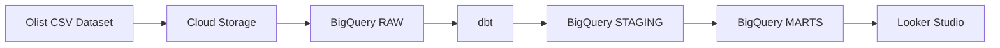
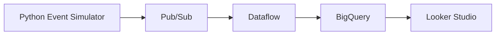

# Retail Analytics Platform - Architecture

## Batch Architecture



## Streaming Architecture



## Data Layers

```text
RAW
 ↓
STAGING
 ↓
MARTS
```

## Main Services

- Cloud Storage
- BigQuery
- dbt
- Looker Studio
- Pub/Sub
- Dataflow
- Cloud Run
- Cloud Scheduler
- Workflows
- IAM
- Secret Manager
- Cloud Logging
- Cloud Monitoring

## DevOps

- Terraform
- Docker
- GitHub Actions
- GitHub

## Optional Extensions

- PySpark
- AI
